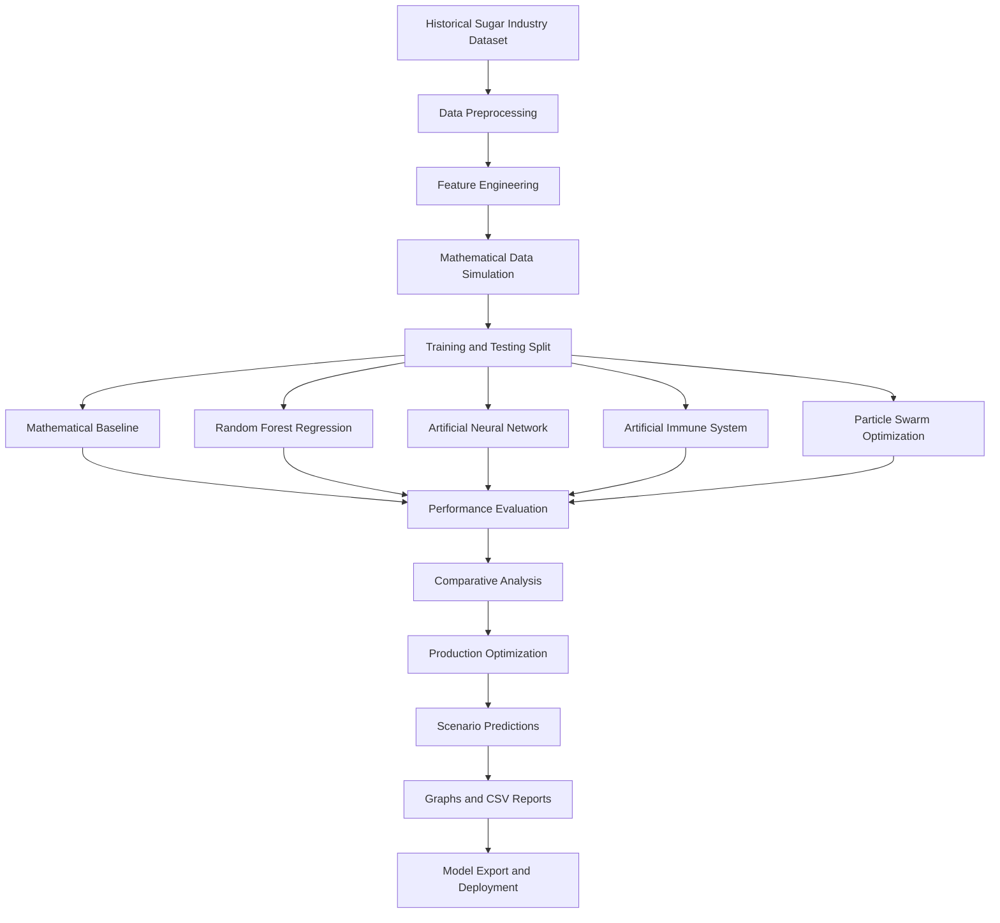
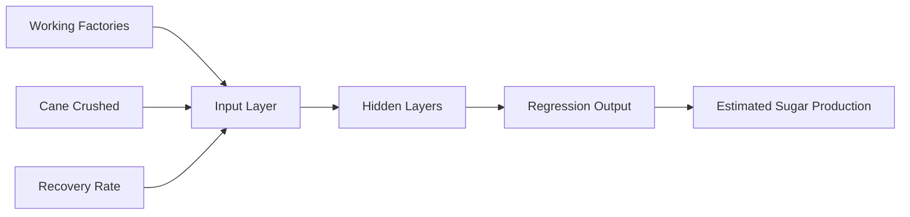
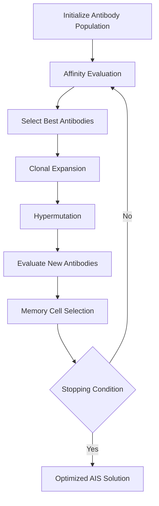
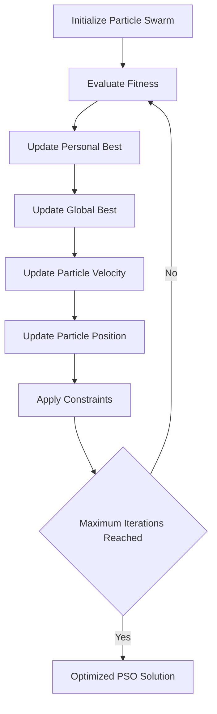
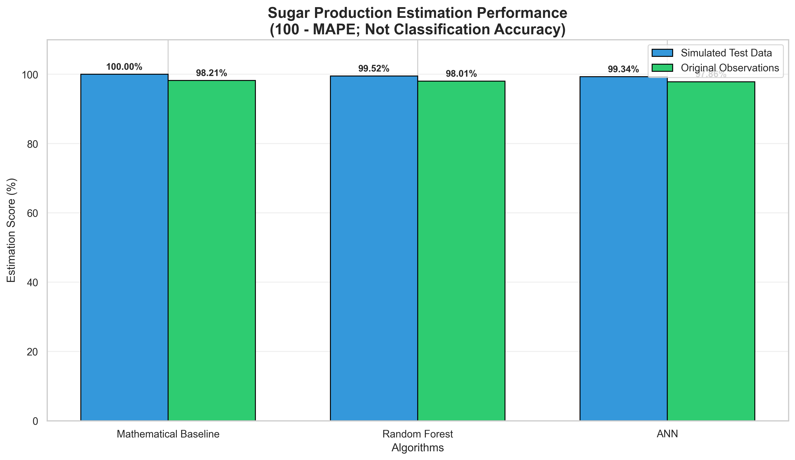

# AI-Based Sugar Industry Performance Analysis and Production Efficiency Optimization Using PSO and AIS

## Project Overview

The AI-Based Sugar Industry Performance Analysis and Production Efficiency Optimization project is an artificial intelligence and machine learning framework designed to analyze sugar industry performance, estimate sugar production, evaluate resource utilization, and optimize production efficiency.

The project integrates conventional machine learning, Artificial Neural Networks (ANN), Artificial Immune Systems (AIS), and Particle Swarm Optimization (PSO) to investigate sugarcane processing efficiency, sugar recovery rates, factory utilization, and production improvement opportunities.

The system utilizes historical sugar industry statistics from Tamil Nadu and All India to perform descriptive analysis, production estimation, comparative model evaluation, and hypothetical production optimization.

## Project Objectives

- Analyze historical sugar industry performance.
- Estimate sugar production using machine learning techniques.
- Analyze sugarcane crushing capacity and utilization.
- Evaluate sugar recovery rates.
- Investigate factory-level production efficiency.
- Implement Artificial Immune System optimization.
- Implement Particle Swarm Optimization.
- Compare conventional and nature-inspired algorithms.
- Identify hypothetical production improvement opportunities.
- Generate production predictions under different scenarios.
- Visualize model performance and industry statistics.
- Export trained models for future applications.

## Dataset Information

**Dataset Name:** Performance of Sugar Industry – Sugar Season 2019

**Dataset File:**

`performance_of_sugar_industry_sugar_season_2019.csv`

The dataset contains historical sugar industry performance indicators for Tamil Nadu and All India.

### Dataset Characteristics

| Attribute | Description |
|---|---|
| Domain | Agriculture and Sugar Industry |
| Dataset Format | CSV |
| Original Rows | 5 |
| Original Columns | 6 |
| Processed Observations | 4 |
| Geographical Coverage | Tamil Nadu and All India |
| Historical Period | 2016–17 and 2017–18 |
| Problem Type | Regression and Optimization |
| Target Variable | Sugar Production |

### Dataset Features

| Feature | Description |
|---|---|
| Number of Factories Working | Number of operational sugar factories |
| Installed Crushing Capacity | Installed sugarcane processing capacity |
| Cane Crushed | Total quantity of sugarcane processed |
| Sugar Production | Total sugar produced from sugarcane |
| Recovery Rate | Percentage of sugar recovered from processed cane |
| Region | Tamil Nadu or All India |
| Season | Sugar production season |

### Engineered Features

- Production per factory
- Cane crushed per factory
- Effective recovery rate
- Recovery rate gap
- Mathematical production estimation
- Polynomial feature interactions
- Production improvement percentage
- Resource utilization indicators

## Technologies Used

| Technology | Purpose |
|---|---|
| Python | Primary programming language |
| Pandas | Data processing and analysis |
| NumPy | Numerical computation |
| Scikit-learn | Machine learning and evaluation |
| TensorFlow | Neural network implementation |
| Keras | Model development and serialization |
| Matplotlib | Data visualization |
| Seaborn | Statistical visualization |
| Joblib | Model serialization |
| PyYAML | Configuration management |
| JSON | Metrics and result storage |
| Jupyter Notebook | Experimental development |

## System Architecture



## Project Methodology

### 1. Data Collection

Historical sugar industry statistics are collected from the CSV dataset containing production, recovery rate, factory utilization, and sugarcane crushing information.

### 2. Data Preprocessing

The preprocessing stage includes:

- Loading the CSV dataset.
- Cleaning column names.
- Handling missing values.
- Converting numerical attributes.
- Transposing the original dataset.
- Extracting geographical information.
- Extracting production seasons.
- Identifying provisional observations.
- Preparing independent and dependent variables.

### 3. Feature Engineering

Additional features are generated to investigate production efficiency and resource utilization.

Production per factory:

$$
ProductionEfficiency = \frac{SugarProduction}{WorkingFactories}
$$

Sugarcane processed per factory:

$$
CanePerFactory = \frac{CaneCrushed}{WorkingFactories}
$$

Effective recovery rate:

$$
EffectiveRecoveryRate =
\frac{SugarProduction}{CaneCrushed} \times 100
$$

### 4. Mathematical Data Simulation

The original dataset contains only four region-season observations, which is insufficient for reliable conventional machine learning training.

Therefore, mathematically simulated production records are generated using controlled variations in:

- Number of operational factories.
- Quantity of sugarcane crushed.
- Sugar recovery rate.
- Factory processing conditions.

The simulated target is calculated using:

$$
P = \frac{C \times R}{100}
$$

Where:

- P = Estimated sugar production
- C = Quantity of sugarcane crushed
- R = Sugar recovery rate

The simulated dataset supports controlled algorithmic experiments but does not represent independently collected industrial observations.

### 5. Model Training

The project investigates the following approaches:

1. Mathematical Baseline
2. Random Forest Regression
3. Artificial Neural Network
4. Artificial Immune System
5. Particle Swarm Optimization

### 6. Model Evaluation

The trained models are evaluated using regression performance metrics.

Simulated test performance and agreement with original historical observations are evaluated separately.

### 7. Production Optimization

AIS and PSO are used to investigate hypothetical production improvements under predefined intervention and processing constraints.

### 8. Prediction and Visualization

The system generates production estimates for different operational scenarios and exports graphical and numerical reports.

## Machine Learning Algorithms

### Mathematical Baseline

The mathematical baseline estimates sugar production directly from sugarcane crushing quantities and recovery rates.

$$
SugarProduction = \frac{CaneCrushed \times RecoveryRate}{100}
$$

This approach provides a transparent reference for evaluating the machine learning and optimization models.

Because the simulated target is generated using this equation, the mathematical baseline is expected to achieve negligible simulation error.

### Random Forest Regression

Random Forest Regression is an ensemble machine learning algorithm that combines predictions from multiple decision trees.

Its purpose in this project is to investigate nonlinear relationships between sugar industry variables and estimated production.

#### Advantages

- Handles nonlinear relationships.
- Supports multiple numerical features.
- Reduces individual decision tree variance.
- Provides feature importance information.
- Supports regression-based production estimation.

### Artificial Neural Network (ANN)

The Artificial Neural Network investigates relationships between sugar industry input variables and production output.

The network receives the industry features and generates a continuous sugar production estimate.

#### ANN Workflow



#### Advantages

- Supports nonlinear function approximation.
- Learns feature interactions.
- Provides continuous numerical predictions.
- Supports model serialization using Keras.
- Can be extended when larger datasets become available.

## Artificial Immune System (AIS)

Artificial Immune System is a nature-inspired optimization technique based on the adaptive behavior of biological immune systems.

In this project, AIS investigates optimized regression parameters and hypothetical sugar production improvements.

### AIS Working Principle

1. Initialize a population of candidate antibodies.
2. Evaluate antibody affinity.
3. Select high-performing antibodies.
4. Generate antibody clones.
5. Apply hypermutation.
6. Evaluate mutated solutions.
7. Preserve the best-performing antibodies.
8. Repeat until the termination condition is reached.

### AIS Architecture



### AIS Affinity Function

An error-based affinity function can be represented as:

$$
Affinity = \frac{1}{1 + Fitness}
$$

Higher affinity represents a candidate solution with lower optimization error.

### AIS Applications

- Regression coefficient optimization.
- Sugar production estimation.
- Recovery rate improvement analysis.
- Resource allocation optimization.
- Hypothetical production efficiency improvement.
- Comparative optimization experiments.

## Particle Swarm Optimization (PSO)

Particle Swarm Optimization is a population-based optimization algorithm inspired by the collective behavior of bird flocks and fish schools.

Each particle represents a candidate solution within the optimization search space.

Particles update their positions based on their individual best solutions and the global best solution discovered by the swarm.

### PSO Working Principle

1. Initialize particle positions and velocities.
2. Evaluate particle fitness.
3. Determine personal best positions.
4. Determine the global best position.
5. Update particle velocities.
6. Update particle positions.
7. Apply search-space constraints.
8. Repeat until convergence or maximum iterations.

### PSO Architecture



### PSO Velocity Equation

$$
v_i^{t+1} =
wv_i^t +
c_1r_1(p_i-x_i^t) +
c_2r_2(g-x_i^t)
$$

### PSO Position Equation

$$
x_i^{t+1} = x_i^t + v_i^{t+1}
$$

Where:

- w = Inertia weight
- c1 = Cognitive coefficient
- c2 = Social coefficient
- r1 and r2 = Random coefficients
- p = Personal best position
- g = Global best position
- v = Particle velocity
- x = Particle position

### Adaptive Inertia Weight

$$
w = w_{max} -
(w_{max}-w_{min})\frac{t}{T}
$$

### PSO Hyperparameters

| Parameter | Value |
|---|---:|
| Swarm Size | 60 |
| Training Iterations | 200 |
| Maximum Inertia Weight | 0.90 |
| Minimum Inertia Weight | 0.40 |
| Cognitive Coefficient | 1.80 |
| Social Coefficient | 1.80 |
| Velocity Limit | 0.20 |
| Simulated Samples | 6000 |
| Training Samples | 3840 |
| Validation Samples | 960 |
| Testing Samples | 1200 |
| Production Optimization Swarm Size | 50 |
| Production Optimization Iterations | 150 |
| Random Seed | 42 |

### PSO Applications

- Regression parameter optimization.
- Sugar production estimation.
- Factory utilization analysis.
- Sugarcane processing optimization.
- Recovery rate optimization.
- Constrained production improvement.
- Scenario-based decision support.

## Production Optimization Framework

The optimization framework investigates production improvement by adjusting operational parameters within hypothetical constraints.

### Decision Variables

- Number of working factories.
- Quantity of sugarcane crushed.
- Sugar recovery rate.

### Optimization Objective

The primary objective is to maximize calculated sugar production while respecting intervention and processing constraints.

$$
P = \frac{C \times R}{100}
$$

The constrained PSO objective is represented as:

$$
\min J =
-\left(\frac{P}{P_0}-1\right)
+0.005B+1000V
$$

Where:

- P = Optimized calculated production
- P0 = Baseline calculated production
- B = Normalized intervention budget usage
- V = Processing constraint violation

### Hypothetical Optimization Constraints

| Constraint | Maximum Value |
|---|---:|
| Factory Expansion | 5% |
| Sugarcane Crushing Increase | 10% |
| Relative Recovery Rate Increase | 5% |
| Maximum Recovery Rate | 13% |
| Cane Per Factory Increase | 10% |
| Normalized Intervention Budget | 1.50 |

These constraints are experimental assumptions and are not verified industrial operating limits.

## Performance Evaluation Metrics

### Mean Absolute Error (MAE)

MAE measures the average absolute difference between actual and predicted production.

$$
MAE = \frac{1}{n}\sum_{i=1}^{n}|y_i-\hat{y}_i|
$$

### Mean Squared Error (MSE)

MSE measures the average squared prediction error.

$$
MSE = \frac{1}{n}\sum_{i=1}^{n}(y_i-\hat{y}_i)^2
$$

### Root Mean Squared Error (RMSE)

RMSE measures prediction error in the original target unit.

$$
RMSE =
\sqrt{\frac{1}{n}\sum_{i=1}^{n}(y_i-\hat{y}_i)^2}
$$

### R-Squared Score

R-squared measures the proportion of target variance explained by the model.

$$
R^2 =
1-\frac{\sum_{i=1}^{n}(y_i-\hat{y}_i)^2}
{\sum_{i=1}^{n}(y_i-\bar{y})^2}
$$

### Mean Absolute Percentage Error (MAPE)

MAPE measures average absolute prediction error as a percentage.

$$
MAPE =
\frac{100}{n}
\sum_{i=1}^{n}
\left|\frac{y_i-\hat{y}_i}{y_i}\right|
$$

### Estimation Performance Score

The project uses an accuracy-like regression visualization calculated as:

$$
EstimationScore = 100 - MAPE
$$

This metric represents percentage-based estimation performance and should not be interpreted as classification accuracy.

### Production Improvement Percentage

$$
Improvement =
\frac{OptimizedProduction-BaselineProduction}
{BaselineProduction}\times100
$$

## Project Visualization

### Model Accuracy and Estimation Performance

The following visualization presents the estimation performance generated by the baseline machine learning implementation.

<p align="center">
  
</p>

The visualization supports the evaluation of sugar production estimation performance.

Actual numerical results are available in the generated metrics and comparison files.

## Additional Visualizations

The project also generates the following visualizations:

| Visualization | Description |
|---|---|
| accuracy_graph.png | Baseline estimation performance |
| heatmap.png | Feature correlation analysis |
| comparison_graph.png | Baseline model comparison |
| result_graph.png | Production analysis |
| prediction_graph.png | Scenario-based production predictions |
| ais_accuracy_graph.png | AIS estimation performance |
| ais_heatmap.png | AIS feature correlation analysis |
| ais_comparison_graph.png | AIS model comparison |
| ais_result_graph.png | AIS production optimization |
| ais_prediction_graph.png | AIS scenario predictions |
| pso_accuracy_graph.png | PSO estimation performance |
| pso_heatmap.png | PSO feature correlation analysis |
| pso_comparison_graph.png | Comparative model evaluation |
| pso_result_graph.png | PSO production optimization |
| pso_prediction_graph.png | PSO scenario predictions |
| pso_convergence_graph.png | PSO training convergence |
| pso_optimization_graph.png | Production optimization convergence |
| pso_feature_importance_graph.png | PSO feature sensitivity |
| pso_improvement_graph.png | Hypothetical production improvement |

## Comparative Algorithm Analysis

| Characteristic | Random Forest | ANN | AIS | PSO |
|---|---|---|---|---|
| Algorithm Type | Ensemble Learning | Deep Learning | Bio-Inspired Optimization | Swarm Intelligence |
| Learning Mechanism | Decision Trees | Neural Network Training | Clonal Selection | Particle Movement |
| Candidate Representation | Decision Trees | Network Parameters | Antibodies | Particles |
| Nonlinear Estimation | Supported | Supported | Supported through model representation | Supported through model representation |
| Explicit Optimization | Limited | Parameter Training | Supported | Supported |
| Population-Based Search | No | No | Yes | Yes |
| Global Search Capability | Limited | Limited | Heuristic | Heuristic |
| Production Optimization | Not Primary | Not Primary | Supported | Supported |
| Model Export | PKL | H5 | PKL/H5 | PKL/H5 |

No algorithm is assumed to be superior before evaluating the generated experimental results.

## AIS vs PSO

| Parameter | AIS | PSO |
|---|---|---|
| Inspiration | Biological Immune System | Swarm Behavior |
| Population | Antibodies | Particles |
| Fitness Mechanism | Affinity Evaluation | Objective Evaluation |
| Exploration | Hypermutation | Particle Movement |
| Exploitation | Clonal Selection | Personal and Global Best |
| Memory Mechanism | Memory Cells | Personal Best and Global Best |
| Search Mechanism | Selection and Mutation | Velocity and Position Updates |
| Production Optimization | Supported | Supported |
| Output Prefix | ais_ | pso_ |

For a fair experimental comparison, both algorithms should use identical datasets, objective functions, constraints, and comparable objective evaluation budgets.

## Production Prediction Scenarios

The project investigates multiple hypothetical production scenarios.

| Scenario | Description |
|---|---|
| Current Conditions | Existing operational parameters |
| Recovery Improvement | Increased sugar recovery rate |
| Increased Cane Availability | Increased sugarcane processing |
| Factory Expansion | Increased number of working factories |
| Combined Improvement | Simultaneous operational improvements |
| Reduced Cane Availability | Reduced sugarcane processing |
| AIS Optimized Scenario | Production parameters selected by AIS |
| PSO Optimized Scenario | Production parameters selected by PSO |

Some hypothetical scenarios may exceed the experimental intervention budget. Feasibility indicators are included in the PSO prediction results.

These predictions are conditional scenario estimates rather than verified future production forecasts.

## Project Directory Structure

```text
AI-Based Sugar Industry Performance Analysis and Production Efficiency/
│
├── README.md
├── performance_of_sugar_industry_sugar_season_2019.csv
│
├── sugar_production_model.h5
├── sugar_production_model.pkl
├── config.yaml
├── metrics.json
│
├── accuracy_graph.png
├── heatmap.png
├── comparison_graph.png
├── result.csv
├── result_graph.png
├── prediction.csv
├── prediction_graph.png
│
├── ais_sugar_production_model.h5
├── ais_sugar_production_model.pkl
├── ais_config.yaml
├── ais_metrics.json
├── ais_accuracy_graph.png
├── ais_heatmap.png
├── ais_comparison_graph.png
├── ais_result.csv
├── ais_result_graph.png
├── ais_prediction.csv
├── ais_prediction_graph.png
│
├── pso_sugar_production_model.h5
├── pso_sugar_production_model.pkl
├── pso_config.yaml
├── pso_metrics.json
├── pso_accuracy_graph.png
├── pso_heatmap.png
├── pso_comparison_graph.png
├── pso_result.csv
├── pso_result_graph.png
├── pso_prediction.csv
├── pso_prediction_graph.png
├── pso_convergence_graph.png
├── pso_optimization_graph.png
├── pso_model_comparison.csv
├── pso_simulation_comparison.csv
├── pso_feature_importance_graph.png
├── pso_regional_summary.csv
└── pso_improvement_graph.png
```

## Installation and Setup

### Step 1: Install Python

Python 3.10 or 3.11 is recommended.

Verify the Python installation:

```bash
python --version
```

### Step 2: Install Required Libraries

```bash
pip install pandas
pip install numpy
pip install matplotlib
pip install seaborn
pip install scikit-learn
pip install tensorflow
pip install h5py
pip install joblib
pip install pyyaml
pip install jupyter
```

Alternatively, install all dependencies using a single command:

```bash
pip install pandas numpy matplotlib seaborn scikit-learn tensorflow h5py joblib pyyaml jupyter
```

### Step 3: Prepare the Dataset

Place the dataset inside the project directory.

```text
performance_of_sugar_industry_sugar_season_2019.csv
```

### Step 4: Configure the Dataset Path

```python
from pathlib import Path

BASE_DIR = Path(
    r"C:\Users\sagni\Downloads\AI-Based Sugar Industry Performance Analysis and Production Efficiency"
)

DATASET_PATH = BASE_DIR / (
    "performance_of_sugar_industry_sugar_season_2019.csv"
)
```

Update the directory path according to your local system.

### Step 5: Launch Jupyter Notebook

```bash
jupyter notebook
```

### Step 6: Execute the Project

Run the implementations in the following order:

1. Baseline machine learning model training.
2. Baseline evaluation and visualization.
3. Artificial Immune System implementation.
4. Particle Swarm Optimization implementation.
5. Comparative performance analysis.

The generated models, graphs, configurations, and CSV reports are saved automatically inside the configured project directory.

## Loading the Trained Models

### Loading the Random Forest Model

```python
import joblib

model = joblib.load(
    "sugar_production_model.pkl"
)

print("Random Forest model loaded successfully.")
```

### Loading the ANN Model

```python
import tensorflow as tf

model = tf.keras.models.load_model(
    "sugar_production_model.h5",
    compile=False
)

print("ANN model loaded successfully.")
```

### Loading the AIS Model

```python
import joblib

ais_model = joblib.load(
    "ais_sugar_production_model.pkl"
)

print("AIS model package loaded successfully.")
```

### Loading the PSO Model

```python
import joblib

pso_model = joblib.load(
    "pso_sugar_production_model.pkl"
)

print("PSO model package loaded successfully.")
```

Only load serialized models from trusted sources.

## Example PSO Production Prediction

The exported PSO H5 model accepts three input features:

1. Number of working factories.
2. Quantity of sugarcane crushed in lakh metric tonnes.
3. Sugar recovery rate in percentage.

```python
import numpy as np
import tensorflow as tf

model = tf.keras.models.load_model(
    "pso_sugar_production_model.h5",
    compile=False
)

sample_input = np.array([
    [37, 81.43, 9.50]
], dtype=np.float32)

prediction = model.predict(
    sample_input,
    verbose=0
)

print(
    "Estimated Sugar Production:",
    prediction[0][0],
    "Lakh Metric Tonnes"
)
```

The corresponding mathematical production estimate is approximately 7.73585 lakh metric tonnes.

The PSO prediction may differ slightly depending on the optimized model parameters.

## Loading the Configuration File

```python
import yaml

with open(
    "pso_config.yaml",
    "r",
    encoding="utf-8"
) as file:

    config = yaml.safe_load(file)

print(config)
```

The configuration file contains:

- Project information.
- Dataset configuration.
- Feature information.
- Model parameters.
- Optimization settings.
- Training information.
- Experimental constraints.
- Research limitations.

## Loading the Evaluation Metrics

```python
import json

with open(
    "pso_metrics.json",
    "r",
    encoding="utf-8"
) as file:

    metrics = json.load(file)

print(
    json.dumps(
        metrics["pso_metrics"],
        indent=4
    )
)
```

## Loading the Production Results

```python
import pandas as pd

results = pd.read_csv(
    "pso_result.csv"
)

print(results.head())
```

The production results include:

- Original factory count.
- Optimized factory count.
- Original sugarcane crushing quantity.
- Optimized sugarcane crushing quantity.
- Original recovery rate.
- Optimized recovery rate.
- Reported sugar production.
- Calculated baseline production.
- Optimized production.
- Additional production.
- Production improvement percentage.
- Intervention budget utilization.
- Optimization fitness.

## Loading the Prediction Results

```python
import pandas as pd

predictions = pd.read_csv(
    "pso_prediction.csv"
)

print(predictions.head())
```

The prediction report includes:

- Region.
- Reference production season.
- Production scenario.
- Number of working factories.
- Sugarcane crushing quantity.
- Recovery rate.
- Mathematical production estimate.
- PSO production prediction.
- Expected production change.
- Improvement percentage.
- Performance category.
- Scenario feasibility.

## Key Features

- Automated dataset preprocessing.
- Historical sugar industry performance analysis.
- Mathematical production simulation.
- Machine learning-based production estimation.
- Artificial Neural Network implementation.
- Artificial Immune System optimization.
- Particle Swarm Optimization.
- Polynomial feature engineering.
- Adaptive PSO inertia weight.
- Constrained production optimization.
- Scenario-based production estimation.
- Comparative algorithm evaluation.
- Correlation heatmap generation.
- Optimization convergence visualization.
- Feature sensitivity analysis.
- Regional performance reporting.
- Automated CSV result generation.
- H5 and PKL model serialization.
- YAML configuration management.
- JSON performance reporting.
- Reproducible experimental configuration.

## Research Contribution

The project presents an experimental framework for investigating the application of conventional machine learning and nature-inspired optimization algorithms to sugar industry performance analysis.

The main contributions include:

1. Integration of mathematical production estimation with machine learning.

2. Comparative investigation of Random Forest, ANN, AIS, and PSO.

3. Application of nature-inspired algorithms to constrained sugar production optimization.

4. Analysis of sugarcane processing, recovery rates, and factory utilization.

5. Development of a reproducible simulation-based experimental framework.

6. Scenario-based analysis of hypothetical operational improvements.

7. Automated generation of reusable models, performance reports, and visualizations.

8. Separation of simulated model evaluation from historical observation analysis.

These contributions represent the scope of the experimental project rather than a claim of established research novelty.

## Applications

The framework can be extended for the following applications:

- Sugar industry performance monitoring.
- Agricultural production analysis.
- Sugarcane supply chain management.
- Factory resource allocation.
- Industrial production planning.
- Sugar recovery rate analysis.
- Agricultural decision support systems.
- Production capacity planning.
- Regional industrial performance analysis.
- AI-based industrial optimization.
- Academic research and comparative algorithm studies.

## Advantages

- Integrates multiple machine learning and optimization techniques.
- Provides transparent mathematical production estimates.
- Supports comparative algorithm evaluation.
- Generates interpretable visualizations.
- Supports reusable trained model exports.
- Investigates multiple operational scenarios.
- Provides explicit optimization constraints.
- Supports reproducible simulation experiments.
- Can be extended with larger industrial datasets.

## Research Limitations

- The original dataset contains only four region-season observations.
- The historical data covers only two production seasons.
- Tamil Nadu is included within the All India aggregate, meaning the observations are not fully independent.
- One installed crushing capacity value is missing.
- All India 2017–18 statistics are provisional.
- Reported production and formula-calculated production do not always agree.
- Simulated training records are not independently collected industrial data.
- High simulated estimation scores do not establish real-world predictive accuracy.
- The mathematical baseline defines the simulated production target.
- Optimization constraints are hypothetical rather than verified industrial limits.
- The intervention budget does not represent actual financial expenditure.
- Correlation analysis is descriptive because of the limited sample size.
- AIS and PSO require multiple independent experimental runs for robust comparison.
- Production improvement estimates require real-world industrial validation.
- The project does not establish that either optimization algorithm is universally superior.

## Future Enhancements

- Integrate larger multi-year sugar industry datasets.
- Include factory-level production statistics.
- Incorporate district-level sugarcane cultivation information.
- Integrate weather and rainfall datasets.
- Include sugarcane quality measurements.
- Incorporate soil and irrigation parameters.
- Analyze industrial energy consumption.
- Include electricity and processing costs.
- Incorporate market prices and sugar demand.
- Develop a hybrid AIS-PSO optimization framework.
- Implement Genetic Algorithm optimization.
- Implement Ant Colony Optimization.
- Implement Grey Wolf Optimization.
- Investigate multi-objective optimization.
- Develop LSTM-based production forecasting using sufficient time-series data.
- Introduce uncertainty quantification.
- Perform statistical significance testing.
- Conduct sensitivity and robustness experiments.
- Develop a Streamlit-based interactive dashboard.
- Develop REST API-based model deployment.
- Integrate real-time industrial IoT monitoring.
- Deploy the system on cloud computing platforms.

## Expected Outcomes

The project is designed to generate:

- Historical sugar industry performance insights.
- Sugar production estimation models.
- Comparative machine learning evaluation.
- AIS-based optimization results.
- PSO-based optimization results.
- Hypothetical production improvement estimates.
- Factory utilization analysis.
- Sugar recovery rate analysis.
- Scenario-based production predictions.
- Reusable machine learning model files.
- Statistical graphs and numerical reports.

Actual performance values should be obtained from the generated CSV and JSON files after executing the project.

## Conclusion

The AI-Based Sugar Industry Performance Analysis and Production Efficiency Optimization project demonstrates the integration of mathematical modeling, machine learning, artificial neural networks, and nature-inspired optimization techniques for sugar industry analysis.

Artificial Immune System and Particle Swarm Optimization provide experimental approaches for investigating regression parameter optimization and constrained production improvement.

The framework generates production estimates, comparative evaluation metrics, optimization results, scenario predictions, and graphical reports.

Although the limited historical dataset prevents strong conclusions about real-world predictive performance, the project provides a foundation for future research using larger industrial datasets and validated operational constraints.

## Author

**Sagnik Patra**

Department of Computer Science and Engineering

KIET Group of Institutions

Ghaziabad, Delhi NCR, Uttar Pradesh, India

### Research Interests

- Artificial Intelligence
- Machine Learning
- Deep Learning
- Artificial Immune Systems
- Particle Swarm Optimization
- Nature-Inspired Computing
- Agricultural Data Analytics
- Industrial Optimization
- Data Science

## References

1. Kennedy, J., and Eberhart, R. (1995). Particle Swarm Optimization. Proceedings of IEEE International Conference on Neural Networks.

2. De Castro, L. N., and Von Zuben, F. J. (2002). Learning and Optimization Using the Clonal Selection Principle. IEEE Transactions on Evolutionary Computation.

3. Breiman, L. (2001). Random Forests. Machine Learning, 45, 5–32.

4. Goodfellow, I., Bengio, Y., and Courville, A. (2016). Deep Learning. MIT Press.

5. Scikit-learn Documentation: https://scikit-learn.org/

6. TensorFlow Documentation: https://www.tensorflow.org/

7. Pandas Documentation: https://pandas.pydata.org/

8. NumPy Documentation: https://numpy.org/

9. Matplotlib Documentation: https://matplotlib.org/

## License

This project is intended for academic, educational, and research purposes.

Reuse and redistribution are subject to the applicable repository license and original dataset usage terms.

## Acknowledgements

Acknowledgement is extended to the original sugar industry dataset providers, open-source software communities, and researchers whose contributions to machine learning, artificial intelligence, and nature-inspired optimization have supported the development of this experimental framework.

## Keywords

Artificial Intelligence, Machine Learning, Deep Learning, Sugar Industry,
Sugarcane Production, Production Efficiency, Artificial Immune System,
Particle Swarm Optimization, AIS, PSO, Random Forest, Artificial Neural
Network, Agricultural Analytics, Industrial Optimization, Recovery Rate,
Resource Allocation, Regression Analysis, Data Science, Swarm Intelligence,
Bio-Inspired Computing, Production Estimation.

---

<p align="center">
  <b>AI-Based Sugar Industry Performance Analysis and Production Efficiency Optimization</b>
</p>

<p align="center">
  Artificial Intelligence | Machine Learning | AIS | PSO
</p>

<p align="center">
  If you find this project useful, consider giving the repository a star.
</p>
